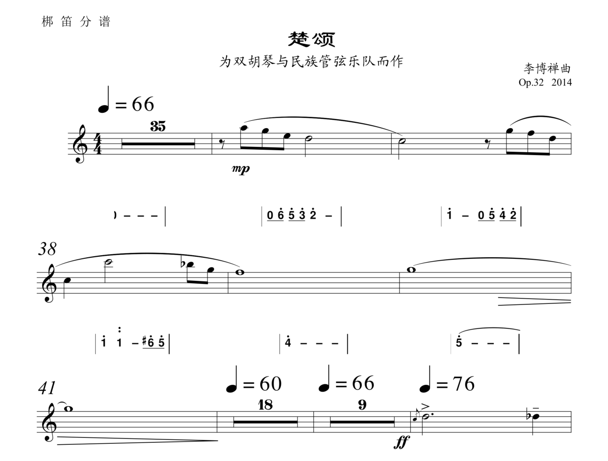
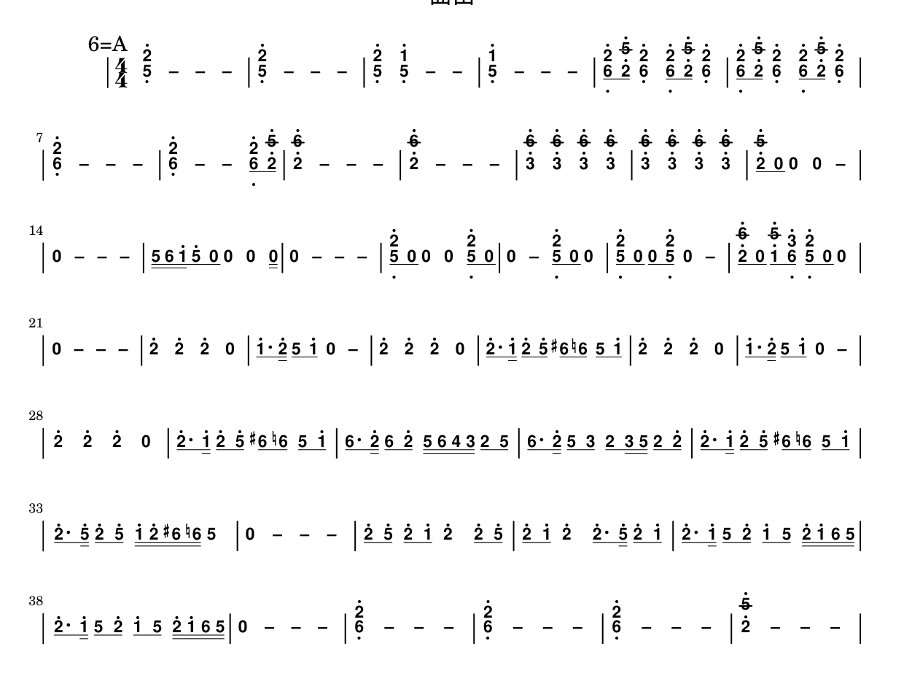

<p align="center">
  
</p>

<h1 align="center">music_translator</h1>

<p align="center">
  <em>五线谱 PDF → 简谱 —— 既能出整页简谱，也能把简谱<b>直接贴回原谱每一行五线谱的下方</b>。</em>
</p>

<p align="center">
  <a href="LICENSE"></a>
  
  
  
  
</p>

<p align="center">
  <a href="#demo">效果</a> ·
  <a href="#modes">两种生成方式</a> ·
  <a href="#install">安装</a> ·
  <a href="#usage">用法</a> ·
  <a href="#how">原理</a> ·
  <a href="#tuning">可调参数</a> ·
  <a href="#limits">已知限制</a> ·
  <a href="#legacy">旧版实现</a>
</p>

---

## ✨ 这是什么

一句话：**五线谱 PDF 进去，简谱 PDF 出来**，而且有两种成品形态。

- **`jianpu` —— 整页简谱。** 干净的一页简谱，只有数字谱，适合打印、发谱、翻谱。
- **`insitu` —— 原位简谱。** 保留原版五线谱的每一行，把对应的简谱**贴在每一行五线谱下方**，一行对一行。适合对照学习、校对、教学。

整条流水线只有一个入口脚本：

```
五线谱 PDF ──OMR──► MusicXML ──┬──► 整页简谱 PDF   (mode=jianpu)
                              ├──► 原位简谱 PDF   (mode=insitu)
                              └──► 两者都要        (mode=both)
```

OMR 用的是 **Homr**（端到端光学乐谱识别，也可切到 Audiveris），
排版走 **music21 → jianpu-ly → LilyPond**，页面合成用 **PyMuPDF** 的矢量操作，
所以输出全部是**矢量 PDF**，放大不糊、可检索、可再编辑。

---

<a id="demo"></a>

## 🖼 效果

### 原位简谱（`--mode insitu`）

每一行五线谱下方，就是这一行的简谱。半个字都不挪动原谱的位置。

下图取自梆笛分谱 `梆笛.pdf`（6 页 A4 矢量谱，51 行谱表）的实测输出：

<p align="center">
  
</p>

### 整页简谱（`--mode jianpu`）

同一份谱子的纯简谱排版，A4 满页，附调号与小节线。

<p align="center">
  
</p>

---

<a id="modes"></a>

## 🧭 两种生成方式

`--mode` 决定出哪种成品，`--engine` 只影响 `insitu` 的实现方式。

| 方式 | 参数 | 产物 | 页面尺寸 | 典型用途 |
| --- | --- | --- | --- | --- |
| 整页简谱 | `--mode jianpu` | `<曲名>.jianpu.pdf` | A4 纵向 | 打印、发谱、只看简谱 |
| 原位简谱（贴字） | `--mode insitu --engine stamp` | `<曲名>.insitu.pdf` | **与原谱完全一致** | 对照学习、校对、原版式交付 |
| 原位简谱（插条） | `--mode insitu --engine strip` | `<曲名>.insitu.pdf` | 每行谱表下方**加长** | 需要给简谱留出连续白位、页面可重排 |

### `stamp` 与 `strip` 的区别

两个引擎都做「五线谱一行 ↔ 简谱一行」的对齐，区别在于简谱放在哪里：

- **`stamp`（默认，矢量贴字）**
  逐行把简谱渲染成一张透明小图，裁掉空白后，用 `page.show_pdf_page(..., overlay=True)` 贴到该行五线谱下方的空白处。
  **不新增页面、不改变页面尺寸**，原谱的版式、页码、裁剪框全部保持原样。
  实测：5 页源谱 → 5 页原位简谱，页面仍为 595×842 pt，`placed 40/40 lines`（40 行谱表全部贴到）。

- **`strip`（插条并加长）**
  检测每一组五线谱系统（system）的位置，在其下方插入一条透明「简谱条」，同时把页面**加高**相应高度。
  好处是简谱永远有连续、完整的一块地方，不会被原谱的歌词或标注挤到；代价是页面变长。
  实测：5 页源谱 → 5 页原位简谱，页面宽度不变、高度按该页行数加高（842 → 1316~1452 pt）。

> 如果你要的是「原版式 + 简谱」，选 `stamp`；如果原谱下方已经很挤、或者要重新排版打印，选 `strip`。

---

<a id="install"></a>

## 📦 安装

### 1. 本项目 + Python 环境

```bash
git clone https://github.com/starpacker/music_translator.git
cd music_translator

python -m venv .venv && source .venv/bin/activate      # 建议 Python 3.10+
pip install -r requirements.txt
```

### 2. LilyPond（必需，系统级）

```bash
# Debian / Ubuntu
sudo apt install lilypond        # 需 2.22 及以上
# macOS
brew install lilypond
```

脚本在 `PATH` 里找不到 `lilypond` 时，可以用 `LILYPOND` 环境变量指定：

```bash
export LILYPOND=/usr/local/bin/lilypond
```

### 3. 内置 OMR 与排版核心

仓库现在包含维护过的 SumisoraOMR `core/` 和 `scripts/jianpu-ly.py`，无需另行克隆上游。
`homr_shim.py` 适配官方 pip 版 Homr；首次识谱需要下载模型权重。
需要测试其他上游版本时，可以用 `SUMISORA_ROOT` 显式覆盖内置核心。

只想排版时，用 `--mxl` 传入 MusicXML，跳过 OMR。

### 4. NVIDIA GPU（可选）

默认安装由 Homr 解析 ONNX Runtime 依赖。CPU 环境可直接运行。
NVIDIA CUDA 环境需要兼容的 CUDA、cuDNN 运行库，以及 GPU 版 ONNX Runtime：

```bash
pip uninstall -y onnxruntime onnxruntime-directml
pip install onnxruntime-gpu
python -c "import onnxruntime as rt; print(rt.get_available_providers())"
```

输出应包含 `CUDAExecutionProvider`。同一环境只安装一种 ONNX Runtime 后端。
`--gpu auto` 同时检测 CUDA 和 Windows DirectML；`--gpu off` 强制使用 CPU。
GPU 推理初始化失败时，识谱流程会按现有逻辑尝试回退 CPU，实际设备以日志为准。

---

<a id="usage"></a>

## 🚀 用法

### 串行处理整个目录

```bash
python batch.py input/吹管 -o output --mode both --engine strip --gpu auto
```

逐份处理目录内 PDF，输出 `<曲名>.jianpu.pdf`、`<曲名>.insitu.pdf` 和逐份日志。
批处理默认使用与当前吹管生成流程相同的 `strip` 引擎；单文件命令保留 `stamp` 默认值。
单份失败后继续处理其他输入，最后汇总并返回非零退出码。
中间识谱结果保存在 `output/work/<曲名>/`，再次运行会复用缓存；需要重新识谱时指定新的 `--work` 目录。

### 最常用的一条命令

```bash
python jianpu.py 曲笛.pdf
```

默认 `--mode both`，一次产出两份：

```
曲笛.jianpu.pdf     # 整页简谱
曲笛.insitu.pdf     # 原位简谱（stamp 引擎）
```

### 只要其中一种

```bash
# 整页简谱
python jianpu.py 曲笛.pdf --mode jianpu

# 原位简谱：保持原页码、原页面尺寸
python jianpu.py 曲笛.pdf --mode insitu --engine stamp

# 原位简谱：插条并把页面加长
python jianpu.py 曲笛.pdf --mode insitu --engine strip
```

### 跳过 OMR（已有 MusicXML）

```bash
python jianpu.py 曲笛.pdf --mxl 曲笛.musicxml --mode both
```

OMR 结果默认缓存在 `<输出目录>/work/<曲名>.musicxml`，第二次运行会直接复用：

```
[omr] 复用已有结果 .../work/曲笛.musicxml
```

### 指定输出与前缀

`-o` 在 `mode=both` 时是**前缀**，在单模式下是目标文件名。
推荐只给一个不带后缀的名字，避免出现 `.insitu.insitu.pdf` 这种重叠后缀：

```bash
python jianpu.py 曲笛.pdf -o out/曲笛              # → out/曲笛.jianpu.pdf + out/曲笛.insitu.pdf
python jianpu.py 曲笛.pdf --mode jianpu -o out/曲笛-简谱.pdf
```

### 完整参数

| 参数 | 说明 |
| --- | --- |
| `score` | 源五线谱 PDF（**矢量 PDF 最佳**，扫描件需先 OMR 成矢量或提高分辨率） |
| `-o, --output` | 输出文件；`mode=both` 时作为前缀。默认与输入同名同目录 |
| `--mode {jianpu,insitu,both}` | 产物类型，默认 `both` |
| `--engine {stamp,strip}` | 原位简谱的实现方式，默认 `stamp` |
| `--mxl` | 已有的 MusicXML，给出后跳过 OMR |
| `--work` | OMR 中间结果目录，默认 `<输出目录>/work` |
| `--title` | 简谱标题，默认取输入文件名 |
| `--gpu {auto,on,off}` | OMR 是否用 GPU，默认 `auto` |

---

<a id="how"></a>

## ⚙️ 原理

```
┌──────────────┐   Homr / Audiveris    ┌────────────┐
│ 五线谱 PDF   │ ────────────────────► │ MusicXML   │
└──────────────┘                       └─────┬──────┘
                                             │ music21 解析调号 / 拍号 / 时值
                                             ▼
                                     ┌────────────────┐
                                     │ 简谱文本 (jianpu)│
                                     └───────┬────────┘
                       jianpu-ly.py ─────────┤───────── LilyPond
                                             ▼
                        ┌────────────────────┴────────────────────┐
                        │                                         │
                   整页简谱 PDF                            逐行简谱切片
                   (mode=jianpu)                          (insitu 引擎)
                                                                │
                     ┌──────────────────────────────────────────┴───────────┐
                     │                                                      │
              stamp：检测每行五线谱的                      strip：检测每行五线谱系统，
              位置，矢量贴字到其下方                        插入透明简谱条，页面加高
              （页码 / 尺寸不变）                           （页面变长）
```

三段关键逻辑：

1. **OMR + 缓存** — `jianpu.py:omr_to_musicxml()`。产物落在 `work/` 下，有就直接复用。
2. **MusicXML → 简谱文本** — `music21` 取出调号（首调）、拍号、每个音的时值与八度，
   拼成 `jianpu-ly.py` 能吃的文本。和弦音需要 `OctavesAfter` 头，否则 jianpu-ly 会报
   `Ambiguous octave marks`；`\time` 则被故意丢掉，否则它会在每条五线谱下多印一个节拍记号字形。
3. **对齐** — OMR 给出的换行数常常和原谱对不上（实测 40 行谱表只标出 36 个换行）。
   `insitu/align.py` 用动态规划把「MusicXML 的小节序列」和「PDF 中真实的谱表几何」重新对齐，
   代价函数三项：
   - `_COST_MERGE = 1.0` — OMR 把两行并成了一行
   - `_COST_SPLIT = 1.2` — OMR 凭空造了一个换行
   - `_COST_COUNT = 0.4` — 该行小节数与预期不符

   `insitu/pdf_structure.py` 则从 MuseScore 导出的矢量 PDF 里读出每行谱表的上下沿与谱线，
   `insitu/vendor/score_align.py` 负责最终插入/贴字。

---

<a id="tuning"></a>

## 🔧 可调参数

### 原位贴字（`insitu/render_insitu.py`）

| 常量 | 默认 | 含义 |
| --- | --- | --- |
| `Y_OFFSET` | `20.0` | 简谱墨迹顶端距该行五线谱下沿的距离（pt）。调大 → 简谱整体下移 |
| `STAFF_SIZE` | `20` | jianpu-ly 字号，与原谱简谱字号保持一致 |
| `_LINE_WIDTH_PT` | `540` | 单行简谱渲染宽度（pt），超出会压缩换行 |

### 对齐代价（`insitu/align.py`）

| 常量 | 默认 | 含义 |
| --- | --- | --- |
| `_COST_MERGE` | `1.0` | OMR 把两行谱表合并成一行的代价 |
| `_COST_SPLIT` | `1.2` | OMR 多造出一个换行的代价 |
| `_COST_COUNT` | `0.4` | 每差一个小节的代价 |

调大某项 = 更不信任 OMR 在这方面的判断。

### 插条引擎（`insitu/vendor/score_align.py` 的 `Config`）

| 字段 | 默认 | 含义 |
| --- | --- | --- |
| `render_scale` | `4.0` | 简谱切片渲染倍率，越大越清晰、越慢 |
| `gap_above_pt` / `gap_below_pt` | `9.0` / `9.0` | 谱表与简谱条上下的留白 |
| `insert_height_pt` | `40.0` | 每条简谱条的基础高度 |
| `jianpu_first_left_pt` | `80.0` | 每页第一行简谱的左缩进（给行首符号留位） |
| `jianpu_other_left_pt` | `29.5` | 其余行简谱的左缩进 |
| `page_margin_pt` | `26.0` | 页面左右安全边距 |
| `jianpu_gap_pt` | `6.0` | 相邻两行简谱之间的间距 |
| `system_label_clearance_pt` | `31.5` | 避开行首系统标记（括号/谱号）所需空间 |
| `final_system_search_pt` | `46.0` | 最后一行系统的搜索半径 |
| `row_band_pt` | `30.0` | 谱表行高扫描带 |
| `cell_pad_pt` | `0.8` | 单元格左右内边距 |
| `cell_top_pad_pt` / `cell_bottom_pad_pt` | `2.5` / `21.5` | 单元格上下内边距（下边距含八度点与减时线） |

---

## 🧪 实测数据

以仓库自带的 `曲笛.pdf` 为例（5 页 A4 矢量谱，595×842 pt）：

| 项目 | 结果 |
| --- | --- |
| OMR 识别 | 193 小节，4/4 拍，调号 1=D |
| 整页简谱 | 3 页 A4（595.3×841.9），62 KB |
| 原位简谱 `stamp` | **5 页**（595×842，与原谱同尺寸），`placed 40/40 lines` |
| 原位简谱 `strip` | **5 页**（每页按行数加高到 1316–1452 pt） |
| 对齐 | 谱面 40 行谱表，OMR 只标出 36 个换行，DP 重排后 40 行全部贴上 |

---

<a id="limits"></a>

## ⚠️ 已知限制

- **单声部旋律谱**。合唱、钢琴大谱表、复调作品还没有针对性处理。
- **OMR 精度决定上限**。识别错音、错时值会原样带到简谱里；原位简谱能让你一眼看出错在哪一行，这正是它的用处。
- **`strip` 引擎的行检测是针对 MuseScore 矢量导出调的**。其它软件（Finale、Sibelius、Dorico）导出的 PDF 可能需要微调 `score_align.Config` 里的边距参数；`stamp` 引擎依赖 `pdf_structure.py` 读矢量谱线，纯扫描件请先转矢量。
- **跨页 / 跨行连音线**只保证单行内正确，跨系统的延音线暂不重绘。
- **调号**按首调（`1=D` 之类）标注；临时升降号会在音符前带 `#`/`b`。

---

## 🗂 目录结构

```
music_translator/
├── jianpu.py                 # 唯一入口：PDF → 整页简谱 / 原位简谱
├── batch.py                  # 目录级串行批处理，两种 PDF 与逐份日志
├── core/                     # 内置 SumisoraOMR 核心及本地修复
├── scripts/jianpu-ly.py       # 含合音八度与升降号修复的排版预处理器
├── tests/                    # 回归测试和固定输入样本
├── _env.py                   # 环境探测：SUMISORA_ROOT、lilypond、python
├── homr_shim.py              # SumisoraOMR homr_runner ↔ pip 版 homr 的适配层
├── requirements.txt          # 新管线依赖
├── insitu/
│   ├── align.py              # MusicXML 小节序列 ↔ PDF 谱表几何 的动态规划对齐
│   ├── pdf_structure.py      # 从矢量 PDF 读出每行谱表的位置、谱线、小节线
│   ├── render_insitu.py      # stamp 引擎：逐行渲染简谱并矢量贴字
│   └── vendor/score_align.py # strip 引擎：检测系统、插入简谱条、加长页面
├── tools/make_assets.py      # 生成 assets/logo 与 assets/social-preview
├── assets/                   # 图标与社交预览图（SVG + PNG）
├── docs/screenshots/         # README 用截图
├── 曲笛.pdf / 二胡.pdf        # 示例输入
└── prototype_cv/             # 旧版：纯 CV 模板匹配实现（见下文）
```

<a id="legacy"></a>

## 🧱 旧版实现：`prototype_cv/`

仓库里还留着第一代实现 —— 不依赖 OMR，直接用 OpenCV 在**图片**上做模板匹配：
去谱线 → 检测谱系 → 音符头模板匹配 → 符干/符杠追踪 → 估算时值 → 输出简谱文本或图片。

```bash
cd prototype_cv
pip install opencv-python numpy Pillow
python main.py ../input/erhu_p1.png
```

它的实测精度（`prototype_cv/evaluate.py`）：

| 测试曲目 | 小节 | 事件 | 音高 |
| --- | --- | --- | --- |
| 钢琴 K.331 | 20/20 (100%) | 111/111 (100%) | 213/213 (100%) |
| 二胡 8 页 | 93% | 97% | 99% |
| 曲笛 5 页 | 81% | 86% | 90% |

**为什么不继续用它：** 模板匹配对字体、扫描质量、倾斜非常敏感，换个出版社就得重做模板；
而且它输出的是文本/位图，无法把简谱精确地贴回原谱的每一行。
现在的 `jianpu.py` 走 OMR → MusicXML 路线，通用性和版式还原都更好。`prototype_cv/` 保留作对照与参考。

---

## 📄 许可

本项目以 **GNU Affero General Public License v3.0** 发布，见 [LICENSE](LICENSE)。
选 AGPL 是因为运行期依赖链里有 AGPL 组件（SumisoraOMR、Homr、PyMuPDF）。

第三方组件的版本、许可与本地修改说明见 [THIRD_PARTY_NOTICES.md](THIRD_PARTY_NOTICES.md)。

---

<p align="center">
  <sub>如果这个项目帮到了你，点个 ⭐ 让更多人看到。</sub>
</p>

## 本次识谱修复与验证

- 保留合音中每个音的八度和临时升降号，隐藏简谱辅助谱表的加线。
- 不因 OMR 拍号不可靠而截断实际音符。
- 多小节休止重排出现音符槽位数量歧义时抛错，避免猜测性补休止。
- 对 Maestro 矢量 PDF 中无调号、4/4、可明确判断的全音符合音，按谱面小节几何恢复音高和归属。其他节奏、字体、调号仍依赖 OMR；这不是全谱正确性的保证。

```bash
python -m unittest discover -s tests -v
```

测试使用 `tests/fixtures/` 中的固定样本，不依赖本机批处理缓存。
